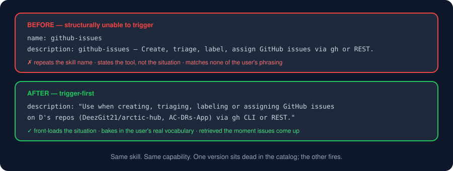
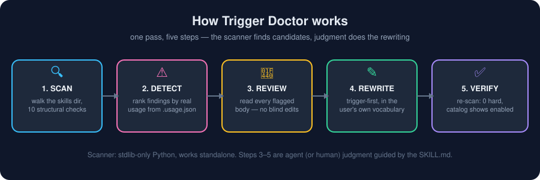
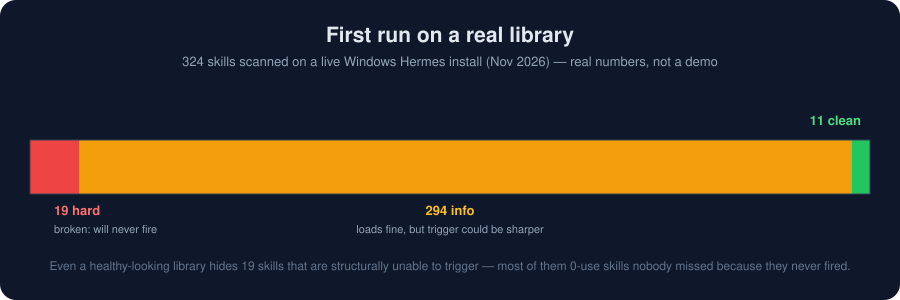

# Trigger Doctor

<p align="center">
  
</p>

A [Hermes Agent](https://github.com/nousresearch/hermes-agent) skill that finds the skills in
your library that **will never fire when they should** — and rewrites their triggers so they do.

**The problem in one picture:** a skill can be installed, enabled, perfectly written on the
inside — and still never load, because its *description* (the only thing the agent sees when
deciding what to retrieve) is structurally unable to match how anyone phrases a request.
The most common defect is so invisible you never suspect it:

```yaml
name: github-issues
description: github-issues — Create, triage, label, assign GitHub issues via gh or REST.
```

That skill was installed for months. It never fired once. The name-prefix makes it match
nothing a user would actually say.

<p align="center">
  
</p>

## What it detects

| Finding | Severity | Why it matters |
|---|---|---|
| Name-prefixed description (`skill-name — does things`) | **hard** | Never matches user phrasing; never retrieved |
| `platforms:` present but excludes the host OS | **hard** | Skill cannot load on this machine *at all* — silently, no error |
| No frontmatter / unclosed frontmatter | **hard** | Index falls back to the first body line |
| Broken `--- ` delimiter (trailing space) | **hard** | Frontmatter silently ignored |
| Placeholder description (`One sentence - what this skill does...`) | **hard** | Zero trigger content |
| Description under 25 chars, no trigger context | **hard** | Fires on nothing (or everything) |
| Frontmatter `name` ≠ directory name | **hard** | Lookup mismatch |
| Generic opener (`Expert guide to...`) | **hard** | Describes a topic, not a situation |
| No `platforms:` field | info | Harmless — loads on all hosts |
| No "Use when..." trigger phrase | info | Capability stated but no situation |
| Description over 250 chars | info | Index cost on every turn |

Findings are ranked by **real usage** from the library's `.usage.json`, so a broken skill you
actually need sorts above a broken skill you never use.

## Proof it matters

<p align="center">
  
</p>

That's the scanner's first run on the library it was built in — a library that had *already*
been curated and hand-cleaned once. It still hid **19 skills that are structurally unable to
trigger**: ten with 1–2 character placeholder descriptions, three with frontmatter names that
don't match their directories, and one skill whose `platforms:` line excludes the host OS
entirely. Most were zero-use skills nobody missed — for the simple reason that they had
never once fired.

## Install

Copy the skill into your Hermes skills directory:

```
git clone https://github.com/DeezGit21/trigger-doctor.git
mkdir -p ~/.hermes/skills            # %LOCALAPPDATA%\hermes\skills on Windows
cp -r trigger-doctor/skills/trigger-doctor ~/.hermes/skills/
```

Start a **new session** (the skill loader is initialized at session start) and say:

> *"run trigger doctor on my skills"*

The SKILL.md drives the whole pass: scan → hand-review → rewrite → verify.

## Standalone use (no agent)

The scanner is stdlib-only Python and works by itself:

```
python skills/trigger-doctor/scripts/audit_triggers.py --skills-dir ~/.hermes/skills
```

| Flag | Meaning |
|---|---|
| `--skills-dir <path>` | Library to scan (default: `$HERMES_HOME/skills` or `~/.hermes/skills`) |
| `--host-os <os>` | Defaults to `sys.platform`; the "platform excludes host" check runs against it |
| `--json` | Machine-readable report (same data, stdout) |
| `--out <path>` | Write the JSON report to a file |

Exit code: `0` = clean, `1` = hard findings, `2` = usage error — so you can drop it into a
cron job or CI and act on failures.

## How the rewrite pass works

The scanner finds candidates; a human (or an agent reading each SKILL.md body) supplies the
judgment. The rewrite pattern that actually triggers:

> **`Use when <situation in the user's own vocabulary> — <capability>.`**

Rules baked into the skill:

- **Front-load the trigger** in the first ~60 chars — some hosts truncate the index there.
- **Bake in the user's real vocabulary** — their project names, repos, tools, file paths.
- **Under ~200 chars** — the description is paid for on every turn; detail belongs in the body.
- **Never repeat the skill name** — describe the situation, not the tool.
- **Never bulk-rewrite from the report alone** — keyword scoring misclassifies; read each skill first.
- **Don't invent triggers** — a description that over-promises fires the skill at wrong
  times, which is worse than one that never fires.
- **0-use + broken is an archive question, not just a rewrite question** — flag it rather
  than silently resurrecting a skill the user may have abandoned on purpose.

## What's in the box

```
skills/trigger-doctor/
├── SKILL.md                 # the agent-facing procedure (scan → review → rewrite → verify)
└── scripts/
    └── audit_triggers.py    # stdlib-only scanner, works standalone
docs/
├── before-after.svg         # the failure mode, illustrated
├── pipeline.svg             # the 5-step pass
└── first-run.svg            # results from the first real scan
```

## FAQ

**Why not just write good descriptions when installing skills?**
That's the endgame — but packs, hub imports and agent-authored skills keep arriving with
broken triggers. This is the safety net that catches them after the fact, plus a periodic
hygiene pass.

**Will a rewritten description cost me context?**
Less than a broken one. Long descriptions get trimmed to ~200 chars in the rewrite — and
the old name-prefixed or placeholder text was paid for every turn while triggering nothing.

**Does it work on non-Hermes skill formats?**
The scanner targets the Hermes SKILL.md convention (frontmatter with `name`, `description`,
`platforms`). The ideas port directly, but the script assumes that layout.

**Is it safe to run on my library?**
The scanner only reads. Rewriting is deliberate and per-skill, guided by the SKILL.md's
review step — nothing is edited in bulk without judgment.

## Provenance

Built out of a real repair session: a GitHub skill family and a trading scanner skill had
been deleted from a user's library after months of "never firing." Auditing the recovered
files showed why — name-prefixed descriptions plus `platforms: [linux, macos]` on a Windows
host. This skill is that audit, generalized so the next library doesn't need a detective.

## License

MIT
